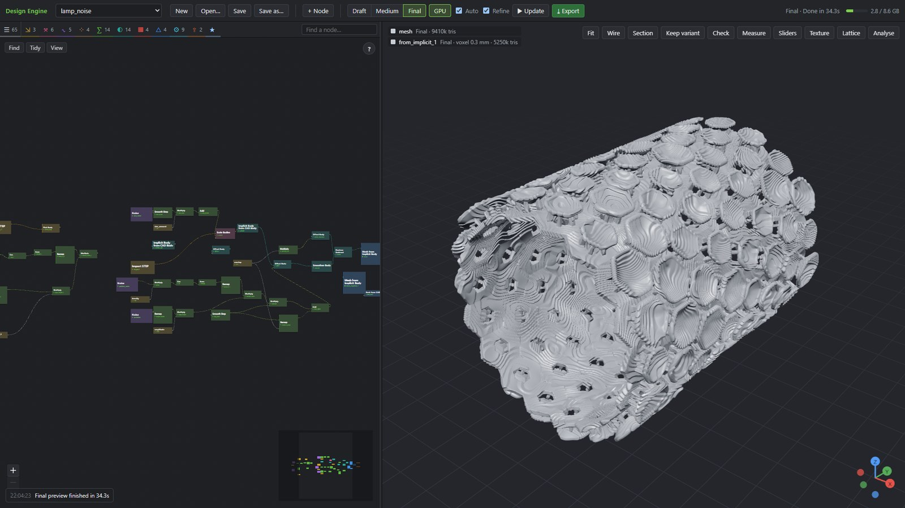
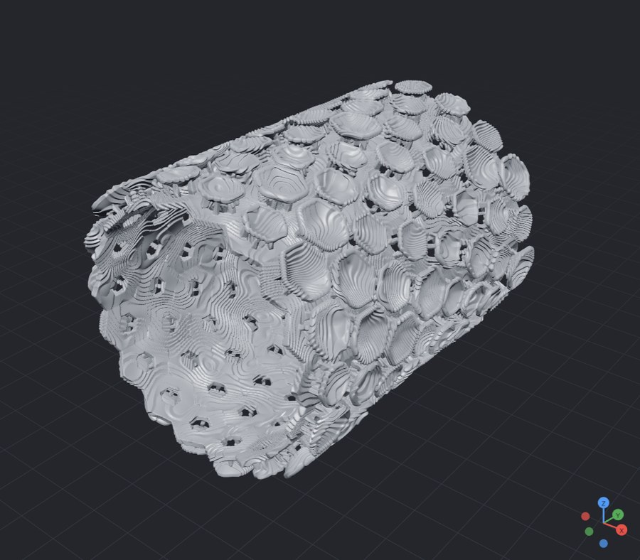
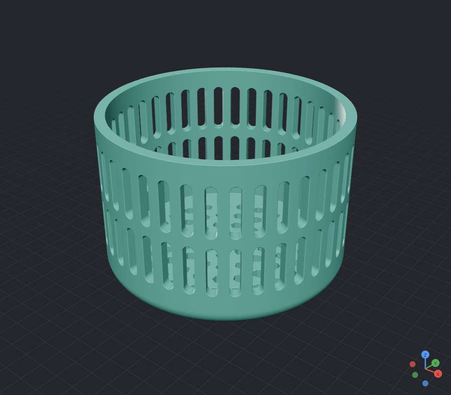
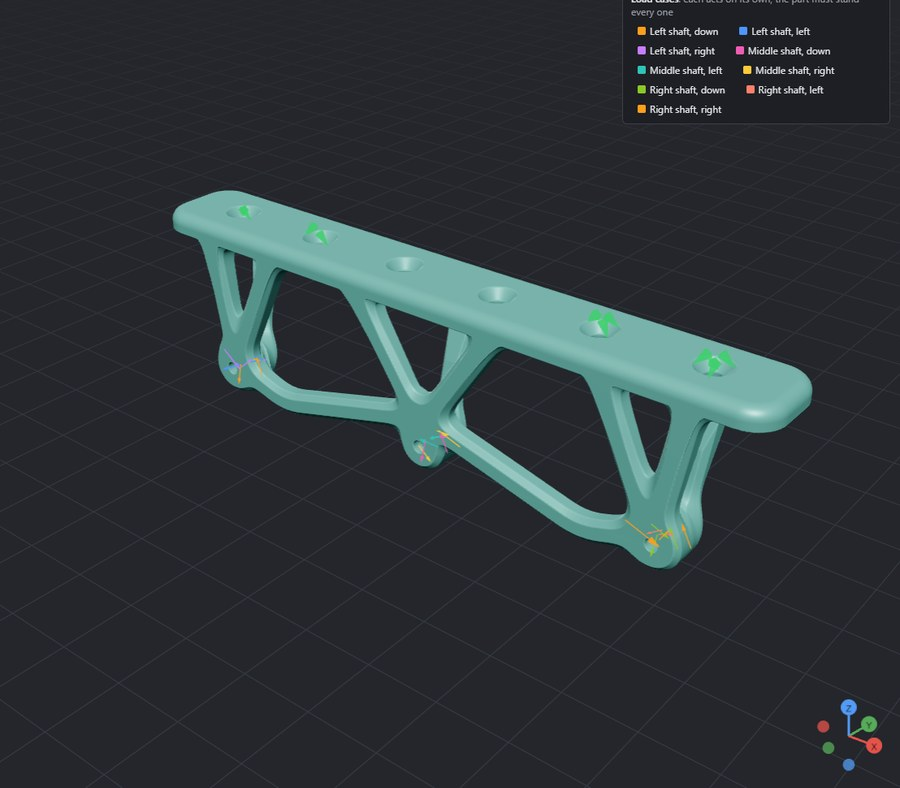
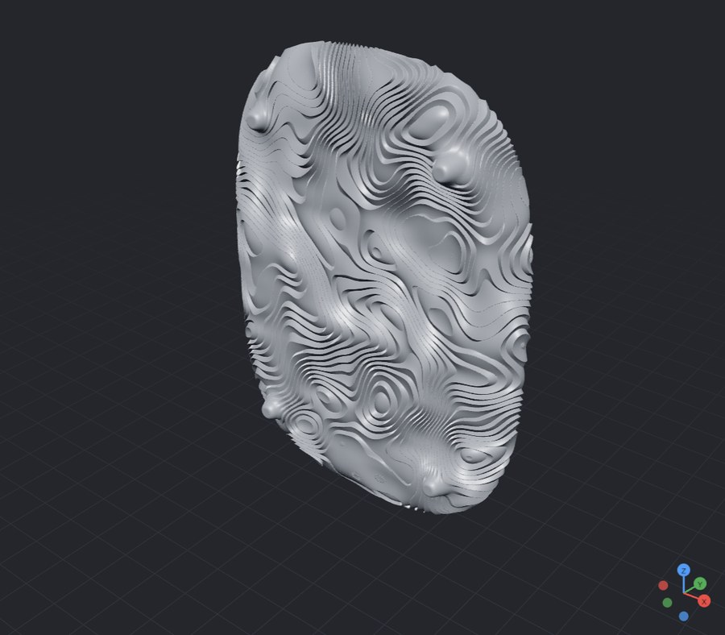
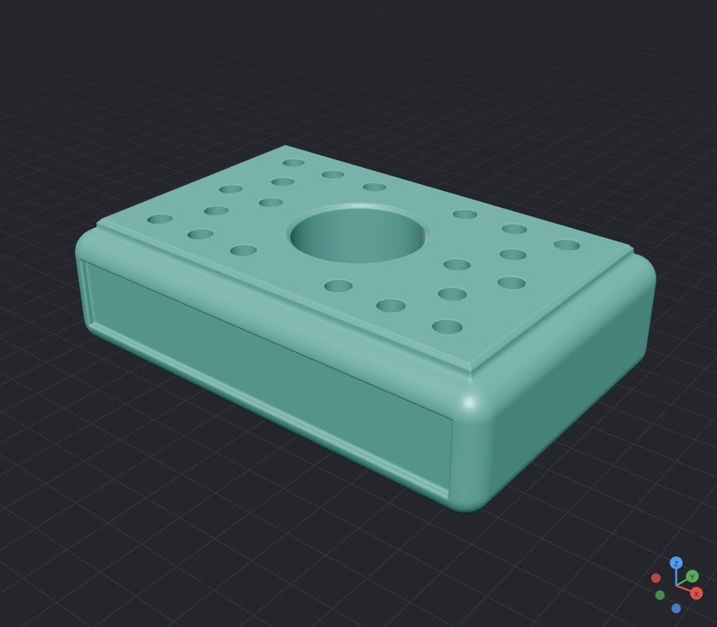
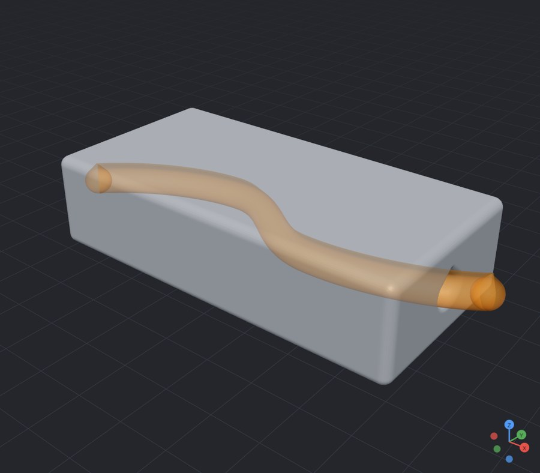
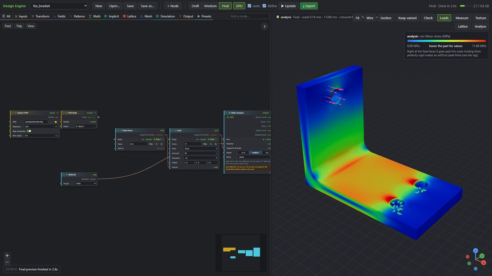

# Design Engine

**Implicit modeling for CAD parts.** Bring in a STEP file, give it a surface texture, vents, a lattice
or an optimized shape in a node graph, see it live in 3D, and export a print-ready STL.



Under the hood every part becomes a **signed distance field**, so offsets, Booleans, fillets, textures
and lattices are plain math on fields, and nothing ever breaks the way mesh Booleans do:

**STEP → triangle mesh → signed distance field → node graph of field math → marching cubes → STL**

---

## What it does

<table>
<tr>
<td width="50%"><br>
<b>Textures</b> — waves, 3D noise, contour ridges and 25 pattern presets (knurl, hex studs, Voronoi
web, dimples…), only on the faces you pick, fading out at their edges.</td>
<td width="50%"><br>
<b>Face patterns</b> — holes, pockets and raised shapes laid out on CAD faces: hexagons, slots,
Voronoi cells, stars, text and pictures. Sizes can follow any field.</td>
</tr>
<tr>
<td><br>
<b>Topology optimization</b> — pick what is held and what is loaded, set how much material to keep,
press Optimize. The result is a smooth, filleted body, checked by its own stress analysis.</td>
<td><br>
<b>Organic surfaces</b> — fields drive everything: ridge height, density, size of the shapes,
so every copy of a part (every lamp petal) comes out unique.</td>
</tr>
<tr>
<td><br>
<b>Modelling on fields</b> — offset chosen faces, shell, smooth, round or chamfer Boolean edges,
fill with TPMS / strut / Voronoi lattices.</td>
<td><br>
<b>Pipes and channels</b> — click points in the 3D view to route a channel or a stem, with a
teardrop roof that prints without supports.</td>
</tr>
</table>



**Simulation** — static stress analysis on a voxel grid (supports, forces, pressure, bearing and torque
loads, load cases), frame optimization (an optimized truss of round or square bars), and print checks
(wall thickness, cavities, separate pieces).

More pictures: [pattern presets](docs/pattern_presets.png) · [patterns sized by a wave](docs/pattern_wave.png) ·
[topology variants](docs/topology_bracket_variants.png) · [frame optimization](docs/frame_f1_bracket.png)

---

## Getting started

**Install once** (Windows, Python 3.12; an NVIDIA card is optional):

```
conda create -n design-engine python=3.12
conda activate design-engine
pip install -r requirements.txt
```

`start.bat` finds a conda environment named `design-engine` by itself. To use another Python, put
`set "DESIGN_ENGINE_PYTHON=C:\path\to\python.exe"` in a `local.bat` next to `start.bat` (it stays out
of the repo). Rebuilding the UI needs Node.js.

**Start** by double-clicking the **Design Engine** shortcut on the desktop, or run `start.bat` in this folder. The
editor opens at http://127.0.0.1:8765. Close the console window to stop it.

- Already running? Starting it again just opens the editor.
- The UI is rebuilt automatically when `frontend/src` changed (needs Node.js).
- Options: `--port 8766`, `--no-browser`, `--no-build`, `--clear-cache`, `--trace`.
- Shortcut gone? `python tools/create_shortcut.py` makes it again.

SolidWorks parts: *File → Save As → STEP AP214*. Recipes that read your own STEP files look in a
`parts/` folder next to `recipes/` (not in the repo: put the files there or link the folder with
`mklink /J parts "D:\path\to\step\files"`).

## A typical session

1. **Open a recipe** (*Open…*) or start from *New*. A recipe is a JSON file of nodes and links:
   `wave_offset.json` is the simplest texture, `lamp_noise.json` the full lamp.
2. **Import STEP** reads the part. A file with many bodies becomes a list, and every node after it
   runs once per body (the lamp's 144 petals flow through the same graph).
3. **Build the graph.** Add nodes from the library ribbon above the graph (click, drag, or press
   **/** to search), or right-click a body in the 3D view: *Texture ▸*, *Holes ▸*, *Modify ▸*,
   *Analyse ▸* insert the right nodes for you, in one undo step.
4. **Pick faces.** Ctrl+click faces in the 3D view, or *Pick* on a node's Faces input. Picked faces
   can be saved under a name and shared between nodes.
5. **Tune.** Every change previews at once: Draft first, then it refines by itself to Medium and
   Final while you pause. Drag an input's name to scrub its value and watch the part follow.
6. **Check and export.** *Check* measures size, volume, weight and wall thickness; **Export** writes
   the STL at full resolution in the background while you keep working.

Wizards walk through the common jobs step by step: **Texture**, **Lattice** and **Analyse** in the
3D view's toolbar.

## Finding your way around

| | |
|---|---|
| **Node graph** (left) | Drag from an output dot to an input dot to connect; colours show the port type and wrong links are refused. Right-click a node to bypass, collapse, group or delete it; right-click a wire to insert a node. **F** puts a frame round the selection, *Tidy* lays the graph out. |
| **3D view** (right) | Click **○** on a node to show it. Left-drag turns, right-drag pans, wheel zooms; **Space** and **1-7** give standard views. A click selects the node that made what is under the cursor; a double-click opens its settings right there. |
| **Section** | Cuts the view open with a plane you can drag. |
| **Keep variant** | Keeps a copy of what is shown beside the result, to compare settings. |
| **Measure** (M) | Wall thickness and member sections under the cursor. |
| **Sliders** | Number nodes as sliders, for quick exploring. |
| **Look at a field** | Show a field node (noise, a mask, math) as a coloured slice, or painted on the bodies. |
| **Groups and presets** | Ctrl+G turns nodes into one reusable node with its Number nodes as settings; *Save as preset* keeps a clip for every recipe (`presets/`). |
| **Undo / save** | Ctrl+Z / Ctrl+Y, Ctrl+S. Unsaved changes are autosaved and offered back after a crash. |

**Quality:** *Draft* uses 4× coarser voxels than the recipe, *Medium* 2×, *Final* the real size.
Only the nodes downstream of a change run again, and each body stays on the same worker process, so
after the first preview an edit typically takes well under a second.

## Command line

`python` is the engine's environment (see *Getting started*), e.g. after `conda activate design-engine`.

```
python run_graph.py recipes\lamp_noise.json --set amplitude.value=0.5
python run_graph.py recipes\wave_offset.json --set import.path=C:/parts/bracket.step --save my_recipe.json
python run_graph.py --nodes
```

`--set NODE.INPUT=VALUE` changes any input for one run, `--save` writes the graph with those changes,
`--nodes` lists every node type.

## Sample recipes

| Recipe | What it shows |
|---|---|
| `wave_offset.json` | The basic texture: Wave → Offset Body → Smoothen Body |
| `lamp_noise.json` | Contour ridges on 3D noise on every lamp petal, petals scaled by noise, all fused into one printable solid |
| `vent_holes.json` | Hole patterns cut through a cup |
| `hex_studs.json` | Raised studs from a Surface Pattern |
| `offset_faces_demo.json` | Offset Faces with a hole pattern on the moved face |
| `pipe_demo.json` | A smooth teardrop channel through a block |
| `fea_bracket.json`, `fea_holes.json` | Static stress analysis |
| `topo_hanger.json`, `topo_hanger_extruded.json` | Topology optimization with load cases, bars, fillets and edges |
| `frame_bracket.json`, `frame_join.json` | Frame optimization |

## Performance and memory

- **GPU:** with an NVIDIA card, distance fields, field math, lattices, marching cubes and FEA run on
  it (NVIDIA Warp and CuPy). The **GPU** button switches it off. The lamp exports in ~2 min instead
  of ~7.
- **Big parts are meshed in blocks** of 96 voxels; only blocks with surface are computed, so memory
  stays low at any size (the textured lamp center at 0.1 mm: 2.7 billion voxels, ~1 min).
- **Caches:** expensive results (distance fields, noise, imported STEP files) are kept in RAM and on
  the SSD (`%LOCALAPPDATA%\DesignEngine\cache`), so restarts and repeated exports are fast.
  `start.bat --clear-cache` empties it.
- **Memory guards:** the engine sets itself a limit, frees caches when the PC runs low and stops a
  run with a message rather than letting the PC run out. The toolbar shows the use.

## Development

```
python -m pytest tests -q -p no:warnings     # engine and server tests (~7 min, CPU)
python -m pytest tests/test_gpu.py --gpu     # GPU against CPU
cd frontend && npm install && npm run build  # rebuild the UI
cd frontend && npm run dev                   # live-reloading UI on :5173 (keep app.py running)
```

New node types are plain functions registered with `@node(...)` in `engine/graph/nodes*.py`; they
appear in the editor by themselves.

| Where | What |
|---|---|
| `engine/cad_import.py`, `engine/sdf.py`, `engine/sdf_gpu.py` | STEP reading, distance fields (CPU and GPU) |
| `engine/fields.py` | Field expressions, Booleans, offsets, smoothing |
| `engine/holes.py`, `engine/pattern2d.py`, `engine/facemask.py` | Face patterns and face masks |
| `engine/lattice.py`, `engine/pipe.py`, `engine/offset_faces.py` | Lattices, pipes, offset faces |
| `engine/fea/`, `engine/frame/` | Stress analysis, topology and frame optimization |
| `engine/meshing.py`, `engine/tiles.py`, `engine/dualcontour.py` | Meshing, blocks, dual contouring |
| `engine/graph/` | Node library, graph model, evaluator, worker processes |
| `engine/server.py`, `frontend/` | The editor's server and UI (React, React Flow, three.js) |

## Further reading

- [docs/FINDINGS.md](docs/FINDINGS.md) — measurements, geometry facts and lessons learned
- [docs/ROADMAP.md](docs/ROADMAP.md), [docs/PATTERN_PLAN.md](docs/PATTERN_PLAN.md),
  [docs/TOPOLOGY_PLAN.md](docs/TOPOLOGY_PLAN.md), [docs/FRAME_PLAN.md](docs/FRAME_PLAN.md),
  [docs/ORGANIC_PARTS_PLAN.md](docs/ORGANIC_PARTS_PLAN.md) — plans and status per feature
- [docs/archive/README_2026-11-25.md](docs/archive/README_2026-11-25.md) — the previous README, with
  detailed how-tos: the lamp's knobs, Face Mask picking, Reduce Mesh and Tolerance, lattices in density
  units, recipe JSON
